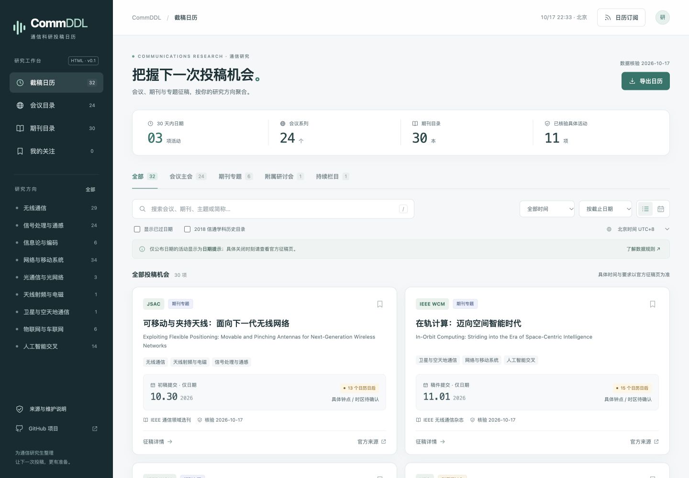

# CommDDL · 通信科研投稿日历

按研究方向查找会议、期刊与专题征稿，追踪有来源的投稿时间。

[在线使用](https://turambarr.github.io/commddl/) · [数据纠错 / 建议收录](https://github.com/turambarr/commddl/issues/new?template=data.yml) · [数据说明](docs/DATA.md)

## 当前版本

这是可直接打开的 HTML（网页文件）版本，没有应用服务器和运行时外部依赖。

首批包含 **24 个会议系列、30 本期刊、11 条已核验的具体活动**。其余会议记录保留官方入口，具体届次和投稿日期标注待核验。数据最近核验：2026-10-17。

可使用的功能：

- 按研究方向、活动类型、关键词和日期范围筛选。
- 会议与期刊目录；中文、英文、简称和部分旧名称搜索。
- 活动详情、投稿时间线、官方来源与延期记录。
- 原时区和北京时间显示；只有明确时刻才显示精确倒计时。
- 手机布局、键盘搜索快捷键 `/`、本地收藏、收藏备份和导入。
- 月历、日历文件导出与公开方向的日期提示订阅。
- 带年份的学校历史目录标签。

目前的真实征稿样本主要来自 IEEE 通信学会专题页面，以及 VTC、ICASSP 和 ISIT 官方入口。**本版尚未核实全部期刊最新 SCIE 收录与各类分区，也尚未完成全部会议的当前届次录入。** 数据范围逐步扩充，覆盖情况在网站中展示。

## 直接打开

下载整个项目后，双击根目录 `index.html` 即可使用；请保持 `assets/` 文件夹在旁边。

如果需要只有一个文件的版本，运行构建后打开 `release/CommDDL.html`。这个文件内嵌数据、样式和交互脚本，可离线查阅。打开外部官方链接仍需要联网。

收藏保存在当前浏览器，浏览器或文件来源改变时可能不会共享收藏，请使用“我的关注”里的备份和导入。

## 本地维护与验证

安装 Node.js（JavaScript 运行环境）20 或更新版本后，在项目目录运行：

```sh
npm test
npm run build
npm run serve
```

无需安装第三方依赖。`npm run serve` 启动本地预览，访问终端显示的地址。

- `npm test`：验证时区、日期精度、摘要前置条件、筛选、延期身份、取消与日历格式。
- `npm run check`：检查字段、引用关系、来源链接格式及时间精度。
- `npm run build`：重新生成网页数据、订阅文件、`dist/` 静态站和单文件版本。

结构检查不能代替对官网事实的核验。

## 更新数据

唯一手工编辑的数据源是 `data/catalog.json`。修改后执行 `npm test` 和 `npm run build`，同时提交原始数据及生成的 `assets/data.js`、`calendars/` 文件。

```text
data/catalog.json       载体、活动、时间节点和来源
assets/app.js           网页交互
assets/core.js          时间、筛选和日历业务规则
assets/styles.css       桌面与手机布局
calendars/              公开日期提示订阅
scripts/                检查与构建
tests/                  关键业务测试
docs/DATA.md            字段和维护规则
```

会议系列、具体届次和专刊分别管理。一个期刊可以有多个专题，同一年会议可以有春秋两届。新增轮次和延期不能混为一件事。详细字段见 [数据维护说明](docs/DATA.md)。

## GitHub Pages 发布

仓库提供 `.github/workflows/pages.yml`：变更先经过测试和构建，主分支通过后部署。

在仓库 **Settings（设置）→ Pages（网页托管）→ Source（来源）** 选择 **GitHub Actions（自动化流程）**。首次配置后可在 Actions 页面运行部署流程。变更请求只校验，不发布。

如果只是手动上传文件，也可选择从主分支根目录发布，因为根目录已经包含可用页面和订阅文件；此时请停用自定义部署流程，避免混用两种发布方式。

## 时间与订阅约定

只有日期、没有钟点或时区的活动保持“仅日期”。官网未写明时区时，不默认补成 AoE（全球任何地方当天结束）。

本版的公开订阅为**全天日期提示**，不表示当天任何时刻均可投稿。下载 `.ics` 文件后导入是一次性快照；订阅在线地址才可能接收之后发布的变动。刷新频率由日历客户端决定。

会议摘要注册、主会全文和附属研讨会分别记录。截止尚未到来，也可能有已经关闭的前置注册步骤。

## 评价与学校目录

SCIE（科学引文索引扩展版）、ESCI（新兴来源引文索引）、JCR（期刊引证报告）分区、中科院分区与 CCF（中国计算机学会）类别需要分别核实、标注年份。

“2018 信通目录”来自北邮公开的历史学科附件。它表示该历史文件中的列名情况，当前适用性需结合学院、年级和培养要求确认；附属研讨会不自动继承主会认定。

## 致谢与许可

参考 [CCFDDL](https://github.com/ccfddl/ccf-deadlines) 的结构化数据维护、截止日历、收藏与订阅思路。本版网页与通信数据模型独立实现。参考源码版本：`ff502c528eea75fb33812d6a742fc6f807fbc212`。

代码采用 [MIT 宽松开源许可证](LICENSE)。官方来源网页及第三方材料版权属于其权利人；项目保存必要的基本事实、短证据和链接。未来直接复用第三方代码时，应保留相应版权及许可声明。
