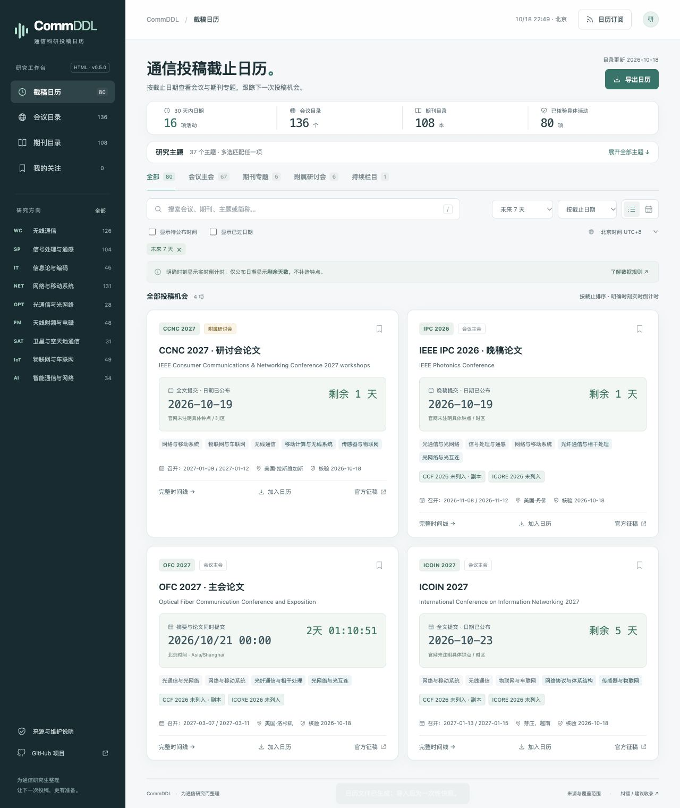

# CommDDL · 通信期刊会议日历

按截稿日期跟踪通信会议与期刊专题，支持实时倒计时、时区换算和日历导出。

[在线使用](https://turambarr.github.io/commddl/) · [纠错 / 补充目录](https://github.com/turambarr/commddl/issues/new?template=data.yml) · [逐项来源](docs/CATALOG.md) · [核验记录](docs/VERIFICATION.md)



## v0.5.0

更新：2026-10-18。主目录 **108 本期刊、136 个会议系列**，9 个方向、37 个主题；另保留 39 项历史参考。具体活动80项，覆盖55个会议系列及期刊专题；75项具有具体投稿截止日期（17项明确时刻、58项仅日期），另有1项持续栏目与4项尚无截稿日期的届次。已过日期可切换查看。

- 首页按最近截稿排列，明确时刻显示秒级倒计时，仅日期显示剩余天数；会议目录直接显示当届截止与召开时间。
- 摘要注册、全文提交、录用通知、终稿分别保存，支持完整时间线、时区换算、日历导出及未来7/30/90/180天筛选。
- 主题分类与评级属性分开，参考 CCFDDL（计算机会议截稿日历）的 `sub` / `rank` 思路；通信方向独立整理。
- 同一评级体系多选匹配任一项，不同体系组合筛选；地址保存筛选条件，可刷新和分享。
- SCIE（科学引文索引扩展版）、ESCI（新兴来源引文索引）、EI（工程索引）、CSCD（中国科学引文数据库）等作为普通索引属性，与 JCR、中科院、CCF、ICORE 同行显示。
- 期刊和会议共用主题分类，保留中文、英文、简称与旧名称搜索。
- 原待核验和未匹配记录逐项复查：明确等级、所查版本未列入、原库非等级状态、更名合并对应未明确、证据不足分别保存。
- 纯 AI、数据库、生物信息等无直接通信关联条目移入历史参考库；保留稳定编号、已有收藏及原表89条映射。
- 本地收藏、备份导入、截止月历、时区换算、日历导出和方向订阅。

逐项截稿来源见 [截止时间核验清单](docs/DEADLINES.md)。

## 数据来源与版本

JCR（期刊引证报告）优先采用 IEEE 出版社2025数据（2026年6月发布，9月快照）；缺项使用政府公开的2024 JCR转录（2025年6月），逐条注明年份、学科及适用刊名。SCIE/ESCI读取明确索引列，不能从分区或影响因子推定。

中科院采用2025升级版，完整对照华北电力大学公开的21772刊转录：108刊中97刊有明确分区，11刊未列入本版；转录与原库证据区分。2026新锐分区不作为中科院2026分区。CCF（中国计算机学会）2026第七版采用与CCFDDL附件字节一致的公开副本，保留副本属性；ICORE（国际合作会议评级）对照官方2026完整库987条。

所有“未列入”仅针对所查版本；网络失败和身份不确定保留具体复查原因。完整证据及尚存缺口见 [核验记录](docs/VERIFICATION.md)，不将未知状态归为最低等级。

## HTML 版本

下载项目后打开根目录 `index.html`，保持 `assets/` 文件夹在旁边。构建后 `release/CommDDL.html` 是内嵌数据、样式与脚本的单文件版本，可离线查目录；外部官网仍需联网。

收藏保存在浏览器，换设备前可在“我的关注”备份。

## 维护与发布

安装 Node.js（JavaScript运行环境）20 或更新版本，无需第三方依赖：

```sh
npm test
npm run check
node scripts/coverage.cjs
npm run build
npm run serve
```

唯一手工数据源为 `data/catalog.json`。构建生成 `assets/data.js`、`calendars/`、`dist/` 和单文件HTML；主分支通过校验后由 GitHub Pages（静态网页托管）自动发布。格式检查不代替事实核验。

```text
data/catalog.json       载体、时间节点与证据
assets/app.js           页面交互
assets/core.js          筛选、时间与日历规则
scripts/                校验、覆盖报告与构建
tests/                  业务回归测试
docs/DATA.md            数据维护约定
docs/CATALOG.md         目录与逐项来源
docs/VERIFICATION.md    复查结果和证据缺口
```

仅有日期时不补造钟点或时区，往届日期不平移到新届次。普通期刊不自动生成活动，附属研讨会不继承主会等级。

## 致谢与许可

参考 [CCFDDL](https://github.com/ccfddl/ccf-deadlines) 的分类、结构化数据及日历维护方法，参考版本 `0390a29918d6a4e5ae50aac2f532535d253cf563`。页面与通信数据独立实现。

代码采用 [MIT宽松开源许可证](LICENSE)。来源材料版权属于原权利人；项目保存必要事实、短证据及链接，不附带评级库全文。早期学校目录的身份映射及文件分析保留在项目历史参考文档中。
