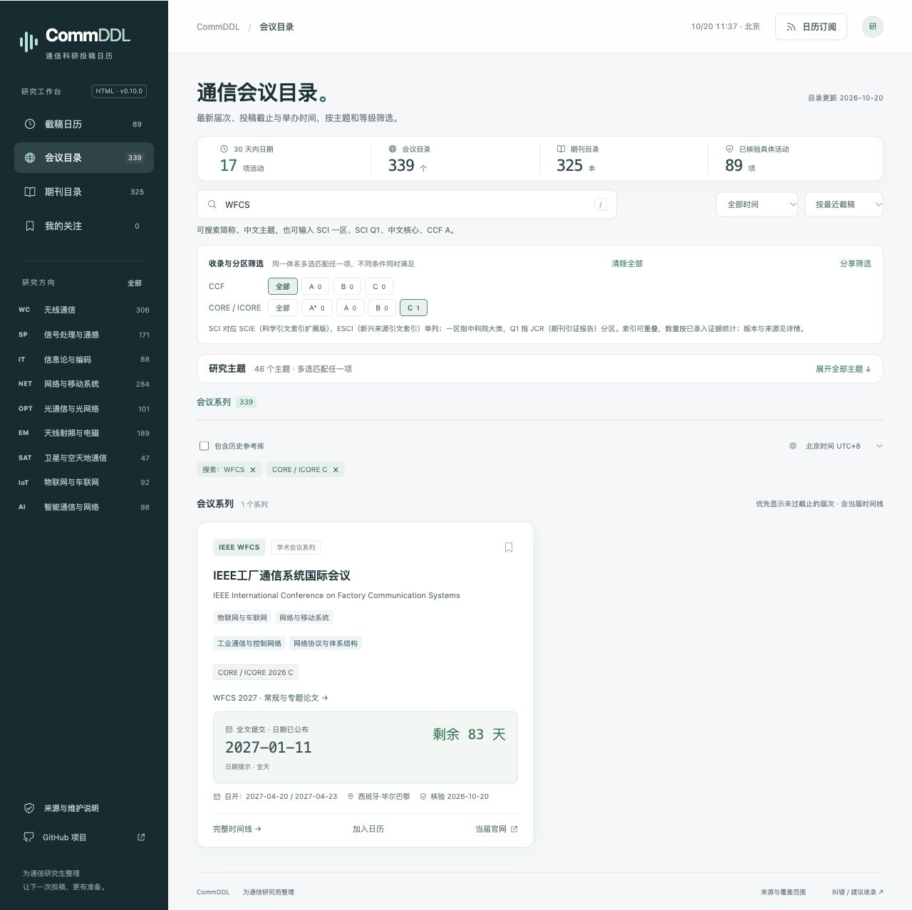

<div align="center">


# CommDDL

**通信研究生的期刊、会议与截稿日历**

从研究方向找到发表渠道，把下一次投稿安排进日历。

**[开始使用 →](https://turambarr.github.io/commddl/)** · [查期刊](https://turambarr.github.io/commddl/#journals) · [找会议](https://turambarr.github.io/commddl/#conferences) · [补充与纠错](https://github.com/turambarr/commddl/issues/new?template=data.yml)

**325 本期刊 · 339 个会议系列 · 9 个方向 · 46 个主题**

网页直接使用 · 无需注册 · 支持手机 · 可导出与订阅日历

</div>

---

## 下一篇论文，投到哪里？

确定研究方向后，选刊、找会、查分区和记截止时间，往往还要来回打开很多页面。

CommDDL 把这些信息放在一起：按通信研究主题浏览发表渠道，组合筛选索引与等级，查看当届征稿时间，再把感兴趣的期刊和会议加入关注。

你可以从一个主题开始，也可以直接输入 `SCI 一区`、`SCI Q1`、`中文核心`、`CCF A` 或期刊、会议简称。

| 现在想做什么 | 直接打开 |
|---|---|
| 找 SCI / SCIE 期刊 | [查看期刊目录 →](https://turambarr.github.io/commddl/#journals?index=SCIE) |
| 找中科院一区的 SCI / SCIE 期刊 | [查看组合筛选 →](https://turambarr.github.io/commddl/#journals?index=SCIE&ranks=cas%3A1) |
| 看近期可以准备的投稿 | [未来 30 天的截稿日期 →](https://turambarr.github.io/commddl/#deadlines?within=30) |
| 从自己的方向找会议 | [从无线通信方向开始 →](https://turambarr.github.io/commddl/#conferences?area=wireless) |

## 从选刊到截稿，一页完成

### 按方向找，也按具体问题找

从无线通信、信息论、信号处理等方向进入，再细分到多天线、通感一体化、信道编码、光网络、卫星导航等主题。每个载体有一个主方向、最多两个辅方向；勾选“仅主方向”，可以进一步聚焦。

### 把你关心的属性组合起来

SCI / SCIE、JCR 分区、中科院分区、CCF 评级和学会分级分别筛选。例如先选 SCI / SCIE，再选中科院一区或二区，最后叠加自己的研究主题。

同一体系多选匹配任一项，不同条件同时满足。搜索框也能识别属性，输入 `SCI 一区 无线` 即可组合查询。

### 看清下一次投稿的时间线

查看具体届次或期刊专题的论文提交、摘要注册、录用通知和终稿日期。明确时刻支持时区换算与实时倒计时；仅公布日期的节点显示剩余天数，并以全天事件导出。

### 建立自己的投稿清单

点击书签关注期刊、会议或具体征稿，集中查看自己的目标。收藏保存在当前浏览器，可导出备份、换设备导入；筛选地址也能直接分享给同学。

### 把日期带进常用日历

按当前结果导出 `.ics` 日历文件，或订阅全部、某个研究方向的投稿日期。导出适合保存一次投稿计划；订阅会接收项目发布的日期更新，刷新频率由日历客户端决定。

## 页面预览



## 覆盖哪些研究方向？

| 研究方向 | 主题举例 |
|---|---|
| 无线通信 | 多天线与波束成形、多址接入、信道建模、全双工 |
| 信号处理与通感 | 检测估计、阵列处理、雷达跟踪、通感一体化 |
| 信息论与编码 | 信息论、信道编码、信源编码、物理层安全 |
| 网络与移动系统 | 网络协议、移动计算、网络管理、通信与网络安全 |
| 光通信与光网络 | 光纤传输、光互连、无线光通信、集成光子学 |
| 天线射频与电磁 | 天线、超表面、微波电路、太赫兹、电磁兼容 |
| 卫星与空天地通信 | 卫星通信、非地面网络、定位导航、无人机通信 |
| 物联网与车联网 | 无线感知、车联网、工业通信、反向散射 |
| 智能通信与网络 | 机器学习、分布式学习、语义与任务导向通信 |

**当前目录快照：v0.10.0 · 2026-10-20。** 主目录共 664 个发表载体，另有 41 项历史参考。网页发布 89 项具体征稿，其中 88 项有投稿截止日期，1 项为持续栏目。常规期刊按载体建档，期刊专题与会议届次单独记录日期。

[浏览完整目录与来源](docs/CATALOG.md) · [查看截止时间清单](docs/DEADLINES.md) · [查看本次目录评估与补充](docs/PACKAGE-REVIEW-v0.10.md)

## 收录、分区与等级，带着年份看

每项属性保留来源、适用年份与复查日期。卡片展示各体系最近有明确记录的年份，详情保留历年属性与出处，方便追溯。

| 属性 | 在 CommDDL 中怎么用 |
|---|---|
| SCI / SCIE、ESCI | 按明确的索引记录筛选；SCI 对应 SCIE（科学引文索引扩展版），ESCI（新兴来源引文索引）单列 |
| JCR（期刊引证报告） | 按 Q1—Q4 筛选，详情列出来源提供的学科分区或汇总口径 |
| 中科院分区 | 按大类一区至四区筛选，详情保留已取得的小类分区 |
| CCF（中国计算机学会）、CORE / ICORE（会议评级） | 按体系和原始年份记录，支持历史目录参考 |
| CIE（中国电子学会）、CIC（中国通信学会） | 两个学会的 T1、T2、T3 分别展示与筛选 |
| EI（工程索引）、CSCD（中国科学引文数据库）及中文核心等 | 作为独立、可重叠的收录属性组合查询 |

<details>
<summary><strong>查看采用的来源版本</strong></summary>

- **JCR**：优先采用 IEEE（电气与电子工程师协会）出版方的 2025 数据，2026 年发布、9 月快照；部分条目采用政府公开的 2024 转录。
- **中科院分区**：对照华北电力大学公开的 2025 升级版 21772 刊转录，按 ISSN（国际标准连续出版物号）或正式刊名匹配。
- **CCF**：参考 2015、2019、2022、2026 年目录。
- **CORE / ICORE**：参考 2008、2013、2014、2017、2018、2020、2021、2023、2026 年官方完整库。
- **CIE**：对照 2023 年电子技术、通信技术领域官方目录，建立 231 项明确对应。
- **CIC**：采用中国科协汇编所载的 2021 年中文 40 刊分级。
- **CSCD**：按 2025—2026 年名单匹配，保留核心库与扩展库区别。

转录、副本与出版方来源在详情中分别标明。具体字段和对应规则见[数据约定](docs/DATA.md)，学校历史文件的版本与适用范围见[政策说明](docs/POLICY.md)。

</details>

## 一起把通信投稿信息补得更好

欢迎补充你熟悉的期刊、会议、专题征稿和延期信息。**补上一个日期、修正一个链接，也能帮到正在准备投稿的同学。**

每个期刊、会议和具体征稿各有一个 YAML 文件。在 GitHub 打开对应文件，编辑后发起 Pull Request（合并请求），附上官方依据；自动检查通过、维护者审核合并后发布。日期信息保留官网的原始日期、钟点、时区与稿件类型。

**让 Agent（智能体）协助补录时，先读 [`data/README.md`](data/README.md)。** [贡献说明](CONTRIBUTING.md)列出了操作步骤；网站条目也提供对应 GitHub 源文件入口。新增条目无需维护公共清单，生成的 JSON 和日历由自动流程处理。

也欢迎提交代码或数据修改，改进分类、搜索、日历与手机体验。如果 CommDDL 对你有帮助，欢迎在 GitHub 点个 Star（收藏项目），或分享给实验室和同学。

## 本地使用与开发

<details>
<summary><strong>本地预览、离线 HTML 与发布方式</strong></summary>

### 启动本地预览

准备 Node.js（JavaScript 脚本运行环境）20 或更新版本，在项目目录运行：

```sh
git clone https://github.com/turambarr/commddl.git
cd commddl
npm ci
npm run build
npm run serve
```

打开终端显示的本地地址，即可预览页面。

### 使用离线版本

构建后生成的 `release/CommDDL.html` 内嵌数据、样式和脚本，可单文件离线查目录；访问期刊、会议官网时连接网络。

构建后也可以打开根目录的 `index.html`，并将 `assets/` 文件夹保留在旁边。

### 修改与检查

```sh
npm test
npm run check
node scripts/coverage.cjs
npm run build
```

| 位置 | 用途 |
|---|---|
| [`data/README.md`](data/README.md) | 面向维护者与 Agent 的字段、来源和提交说明 |
| `data/venues/<主方向>/<编号>.yml` | 每个期刊、会议系列的独立源文件 |
| `data/calls/<年份>/<编号>.yml` | 每届会议、轮次或专题的独立源文件 |
| `data/catalog.json` | 构建时自动合并的完整目录，排除出版本跟踪 |
| `maintenance/` | 编辑核对队列与身份映射 |
| `assets/app.js`、`assets/core.js` | 页面交互、筛选、时间与日历规则 |
| `scripts/`、`tests/` | 校验、构建、覆盖报告与业务测试 |
| `dist/` | 构建后的静态网站与公开目录数据 |
| `release/CommDDL.html` | 构建后的单文件离线版本 |

主分支通过检查后，由 GitHub Actions（自动化工作流）构建并发布至 GitHub Pages（静态网页托管）。维护记录保存在公开仓库中，网页部署使用 `dist/` 内的发布数据。[部署说明](docs/DEPLOYMENT.md)

</details>

## 项目文档

[贡献说明](CONTRIBUTING.md) · [搜索与筛选](docs/FILTERS.md) · [目录与来源](docs/CATALOG.md) · [数据约定](docs/DATA.md) · [质量检查](docs/QA.md) · [版本记录](CHANGELOG.md)

## 致谢与许可

CommDDL 的分类与截稿日历思路受到 [CCFDDL（计算机会议截稿日历）](https://github.com/ccfddl/ccf-deadlines)启发，页面与通信数据独立实现。参考代码版本为 [`0390a29`](https://github.com/ccfddl/ccf-deadlines/tree/0390a29918d6a4e5ae50aac2f532535d253cf563)。感谢学会、出版机构、会议组织者及贡献者提供公开信息与来源。

项目代码采用 [MIT 宽松开源许可证](LICENSE)。来源材料版权归原权利人所有，目录保留必要事实、来源链接与版本记录。
