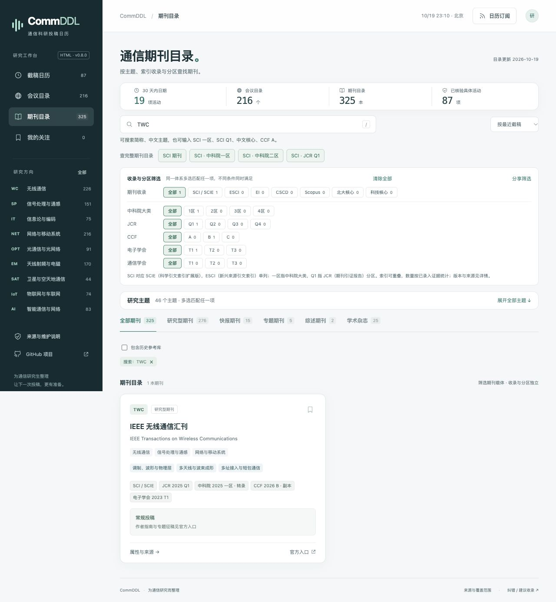

# CommDDL · 通信期刊会议日历

按主题查找通信期刊与会议，跟踪会议和期刊专题的截止日期，安排投稿计划。

[在线使用](https://turambarr.github.io/commddl/) · [补充 / 纠错](https://github.com/turambarr/commddl/issues/new?template=data.yml) · [目录与来源](docs/CATALOG.md) · [版本记录](CHANGELOG.md)



## 当前版本

v0.8.0，2026-10-19。主目录包含 **325本期刊、216个会议系列**，按9个方向、46个主题整理；另保留40项历史参考。网页发布87项具体征稿，其中86项有投稿截止日期，1项为持续栏目。

参考用户提供的总目录，本次新增184本期刊、74个会议系列；补入CIE（中国电子学会）和CIC（中国通信学会）期刊分级，并恢复多年度CCF、CORE/ICORE参考。主辅方向、主题、索引和评级分别筛选。[本次扩充记录](docs/EXPANSION-v0.8.md)

## 查找与跟踪

- 按主辅方向、主题、索引、分区、学会分级和会议评级组合筛选；勾选“仅主方向”可缩小方向匹配。
- 搜索名称、简称、旧名或属性，例如`SCI 一区 无线`、`SCI Q1`、`中文核心`、`CCF A`。
- 查看投稿、摘要注册、录用、终稿时间线；明确时刻支持时区换算和倒计时，仅日期显示全天提示。
- 收藏期刊与会议，导出日历或订阅研究方向；收藏可备份导入。
- 复制筛选地址，分享给同学并恢复查询。

操作说明见[搜索与筛选](docs/FILTERS.md)，具体日期见[截止时间清单](docs/DEADLINES.md)。

## 来源与版本

索引、分区和评级分别记录体系、适用年份、来源及复查日期。SCI对应SCIE（科学引文索引扩展版），ESCI（新兴来源引文索引）单列。EI（工程索引）、CSCD（中国科学引文数据库）、Scopus（摘要与引文数据库）及中文核心属性可重叠。

- **JCR（期刊引证报告）**：优先采用IEEE出版方2025数据（2026年6月发布、9月快照），缺项采用政府公开的2024转录（2025年6月）。
- **中科院分区**：对照华北电力大学公开的2025升级版21772刊转录，按ISSN或正式名称对应。
- **CCF（中国计算机学会）**：参考2015、2019、2022及2026目录，保留每个版本。
- **CORE/ICORE（会议评级）**：参考2008、2013、2014、2017、2018、2020、2021、2023、2026官方完整库。
- **CIE（中国电子学会）**：对照2023电子技术、通信技术领域232刊官方目录，建立231项明确对应。
- **CIC（中国通信学会）**：对照中国科协汇编所载2021中文40刊分级；外国35刊原表未分级。
- **CSCD（中国科学引文数据库）**：按2025—2026名单匹配ISSN，标明核心库、扩展库。

卡片采用同一体系最近有明确记录的年份，详情列出历年属性与来源。网页只包含有依据的属性，维护疑点保存在`maintenance/`及完整源数据中。[核验记录](docs/VERIFICATION.md)用于维护复查，[政策说明](docs/POLICY.md)保留北邮2018年文件及适用范围。

## 使用HTML版本

打开根目录`index.html`，并将`assets/`文件夹保留在旁边。构建后的`release/CommDDL.html`内嵌数据、样式和脚本，可单文件离线查目录；打开外部官网需要联网。

收藏保存在当前浏览器，换设备前可在“我的关注”备份。

## 维护与发布

安装Node.js（JavaScript运行环境）20或更新版本，直接运行：

```sh
npm test
npm run check
node scripts/coverage.cjs
npm run build
npm run serve
```

数据源为`data/catalog.json`。构建生成网页数据、日历订阅和单文件HTML，主分支通过检查后由GitHub Pages（静态网页托管）发布。[部署说明](docs/DEPLOYMENT.md)介绍当前配置、费用及更新流程。

| 位置 | 用途 |
|---|---|
| `data/catalog.json` | 完整载体、时间节点和来源证据 |
| `maintenance/` | 核对队列、文件映射与编辑疑点；不进入网页构建 |
| `dist/data/catalog.json` | 仅包含读者所需属性的网页发布数据 |
| `assets/app.js`、`assets/core.js` | 页面交互、筛选、时间与日历规则 |
| `scripts/` | 结构校验、覆盖报告与构建 |
| `tests/` | 业务回归检查 |
| [数据约定](docs/DATA.md) | 字段、状态和更新规则 |
| [文案约定](docs/WRITING.md) | 页面与来源说明的写法 |
| [版本记录](CHANGELOG.md) | 发布范围、对比和回退入口 |

## 致谢与许可

参考[CCFDDL](https://github.com/ccfddl/ccf-deadlines)的分类、结构化数据及日历维护方法，参考版本`0390a29918d6a4e5ae50aac2f532535d253cf563`。页面与通信数据独立实现。

代码采用[MIT宽松开源许可证](LICENSE)。来源材料版权属于原权利人；项目发布必要事实、短证据及来源链接，完整评级资料保存在本地维护材料中。学校原目录的89条身份映射见[目录文档](docs/CATALOG.md)。
